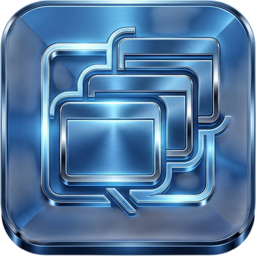

---
hide:
  - navigation
  - toc
---

# WindowManager

Tame the windows of games and emulators: true borderless full screen, exact sizes, moving between
monitors, a picture that fits the monitor to the pixel, a sharper downscaled view, and the PC's display,
GPU and power settings per game.

[Download](https://github.com/RobertoTorino/WindowManager/releases/latest){ .md-button .md-button--primary }
[First steps](wiki/getting-started.md){ .md-button }

!!! info "Beta"
    WindowManager is in beta. It runs on Windows 10 and 11, and on Linux for Steam games under Proton
    (Bazzite, KDE Plasma) with fewer features. Features and layout may still change.

{ .wm-shot loading=lazy }

## See it in action

<video class="wm-shot" controls preload="none" poster="assets/video/demo-poster.jpg" width="100%">
  <source src="assets/video/demo.mp4" type="video/mp4">
  Your browser cannot play this video. <a href="assets/video/demo.mp4">Download it</a> instead.
</video>

A one-minute tour with a stand-in game window: Start, Fit to monitor, the F1 focus switch, Windowed, an exact
size, a snapshot and Kill.

## What it does

-   :material-fullscreen:{ .lg } **Borderless and exact sizes**

    ---

    True borderless full screen, exact window sizes, presets up to 8K, moving the game to another monitor,
    and a window that stays where you put it.

    [:octicons-arrow-right-24: Window controls](wiki/window-controls.md)

-   :material-monitor-screenshot:{ .lg } **Fit to monitor**

    ---

    After Start, the app measures the game's window and works out the exact move and size that make the
    picture fill the monitor. One click applies it.

    [:octicons-arrow-right-24: Fit to monitor](wiki/fit-to-monitor.md)

-   :material-image-filter-hdr:{ .lg } **Downscaled view**

    ---

    The game renders larger than the monitor and is shown scaled down: a sharper picture without anything
    falling off the screen, like an emulator's internal resolution.

    [:octicons-arrow-right-24: Downscaled view](wiki/downscaled-view.md)

-   :material-monitor-dashboard:{ .lg } **Display settings per game**

    ---

    Resolution, refresh rate, HDR, scale and brightness, for the PC or for one game while it runs, and
    put back when it closes.

    [:octicons-arrow-right-24: Display settings](wiki/display-settings.md)

-   :material-speedometer:{ .lg } **Game stats**

    ---

    FPS with the 1 % low, CPU, GPU, RAM and VRAM of the running game, with warnings for what slows games
    down: on battery, the wrong graphics card, power-saving mode.

    [:octicons-arrow-right-24: Game stats](wiki/game-stats.md)

-   :material-expansion-card:{ .lg } **GPU and power**

    ---

    Which graphics card a game uses, driver update checks, power plans and power modes, in one tab.

    [:octicons-arrow-right-24: GPU and power](wiki/gpu-and-power.md)

-   :material-file-cog:{ .lg } **Game config**

    ---

    Render scale, resolution and window written into an Unreal Engine 4 game's own config files on Start,
    with the originals kept. Made for Tekken 7's arcade builds.

    [:octicons-arrow-right-24: Game config](wiki/game-config.md)

-   :material-penguin:{ .lg } **Linux (beta)**

    ---

    Steam games under Proton on Bazzite: scan, launch through Steam, true borderless full screen, focus
    and snapshots.

    [:octicons-arrow-right-24: Linux](wiki/linux.md)

## Get started

1. [Download](wiki/install.md) the newest release and unzip it anywhere.
2. Start `WindowManager.exe`. Your Steam games are already in the list.
3. Pick a game, press **Start**, and let [Fit to monitor](wiki/fit-to-monitor.md) make it fill the screen.

[Download and install](wiki/install.md){ .md-button .md-button--primary }
[First steps](wiki/getting-started.md){ .md-button }
[All shortcuts](wiki/shortcuts.md){ .md-button }

## FAQ

??? question "Does it change the game itself?"
    No, with two exceptions you switch on yourself. Most features change only the game's *window*: its
    size, place and frame. The **Game config** tab edits a game's config files (and keeps the originals),
    and the **HelixSR** tab puts an upscaler DLL into a game (and keeps the original DLL).

??? question "Is it safe with online games and anti-cheat?"
    Moving and resizing windows is what Windows itself does. The downscaled view only reads the window's
    picture. Replacing a DLL with HelixSR may not be accepted by anti-cheat: use that at your own risk.

??? question "Does it need administrator rights?"
    No. Run it as administrator only when the game runs as administrator (Windows does not let a normal
    program touch an elevated one), or for the FPS counter, which also works after
    [adding your account to Performance Log Users](wiki/game-stats.md#adding-your-account-to-performance-log-users).

??? question "Where does it keep its settings?"
    Next to `WindowManager.exe`: the games, settings and logs. Nothing goes in the registry. See
    [Files and settings](wiki/files.md).

??? question "Something went wrong. Where do I look?"
    **File > View logs...** (Ctrl+L) shows the app's log and a log per game. See
    [Logs and troubleshooting](wiki/logs-and-troubleshooting.md).

## License

WindowManager is free software under the [GPL-3.0](https://github.com/RobertoTorino/WindowManager/blob/main/LICENSE).
It is not affiliated with Microsoft, NVIDIA, AMD, Intel, Valve or any game publisher. HelixSR is a separate
project by its own authors.
