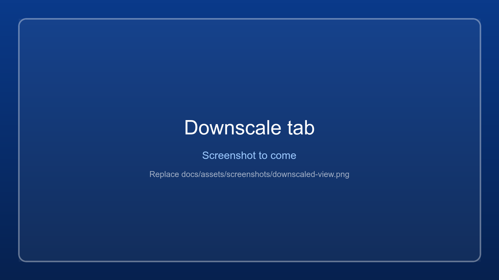

# Downscaled view

A sharper picture without anything falling off the screen. The game window is made large
(for example 2x the monitor, so the game renders 4 times as many pixels) and kept out of
sight, while a full-screen overlay on the monitor shows a live, scaled-down copy.

Everything fits on the monitor and looks smoother, like the *internal resolution* setting of an emulator or
the GPU's DSR / VSR.

Windows only for now: on Linux the downscaled view is not available yet (see [Linux](linux.md)).

{ .wm-shot loading=lazy }

## Using it (Downscale tab)

1. Select the game window first (Scan).
2. **Show on:** the monitor that shows the picture.
3. **Sharpness:** 1.5x, 2x, 3x or 4x. The line below says exactly what will happen, for example
   *"The game will render 3160 x 2160, shown as 1580 x 1080 on monitor 1."*
4. **Picture shape:** the game's current shape, the monitor's, or 4:3 / 16:9 / 16:10.
   A mismatch gets black bars, never stretching.
5. **Forward the mouse to the game** (on by default).
6. **Start downscaled view.**

**Stop** with the Stop button, **Ctrl+Alt+D** (works from anywhere), *View > Stop downscaled
view*, by closing the game, or by closing this app. The game window is restored exactly
as it was.

## What to expect

- It only adds detail if the game re-creates its picture at the window size (RPCS3 and most
  GPU-rendered emulators do). If it renders at a fixed size and stretches, nothing improves. A quick
  test: after starting, the game's own picture should look crisper than at normal size.
- Keyboard and gamepad keep going to the game.
- **Mouse.** With *Forward the mouse to the game* ticked, the position and clicks on the picture are
  mapped back to the game's own coordinates and sent to it: movement, left / right / middle / side
  buttons, double-click and the wheel. A click at a point on the picture lands on the same point of the
  game's picture, however much it is scaled down. The black bars are ignored, and dragging with a button
  held keeps tracking even if you leave the picture. This works for games that read the mouse from their
  window messages (Qt, SDL and GLFW based programs, which should include RPCS3's basic mouse handler).
  Games that read the mouse through raw input, DirectInput or the global cursor position cannot see
  forwarded input: untick the option for those.
- While running, the game window loses its borders and is parked behind the overlay (or just beyond
  the right edge of the desktop if it would otherwise show on another monitor). This app stays above
  the overlay so you can still use it.
- **Stability** is switched off when the view starts.
- Some games set their window back to their own resolution after start-up, or every time they get
  the focus (Tekken 7 goes back to its 1280 x 720 setting). The view puts the window back each time.
  If a game does that more than 5 times within 10 seconds, the view follows the game's size until it
  has been quiet for 10 seconds, so the two do not fight. Setting the game's own resolution to the
  monitor's avoids it altogether.
- The black overlay always covers exactly the chosen monitor, also on a monitor with another display
  scale than the one the app or the game is on.
- It costs GPU power and video memory. Render sizes above 16384 pixels are refused.
- Windowed and borderless games only. If the game runs as administrator, run this app as
  administrator too.
- Tested with a Direct3D 11 test program (the whole surface, including the parts far beyond the monitor
  edge, is mirrored and updates live). Software-drawn (GDI-only) windows are only painted inside the
  desktop, so only that part would show.

The view logs its layout to the game log (`ScaledView` lines); see
[Logs and troubleshooting](logs-and-troubleshooting.md#the-games-windows-focus-and-mouse).
