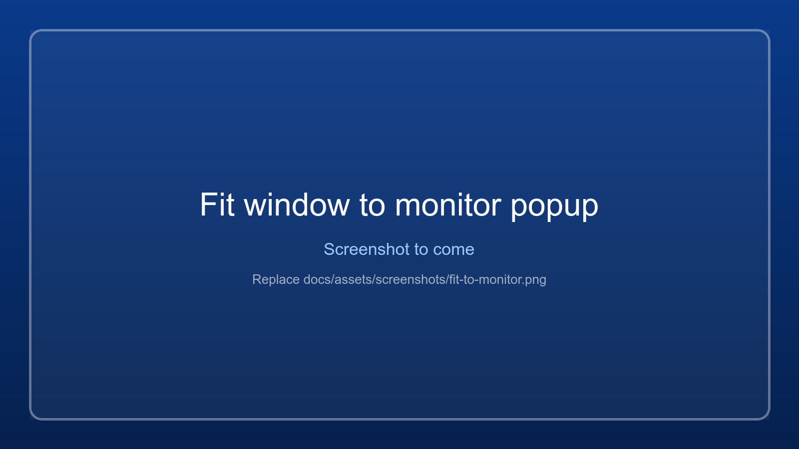

# Fit to monitor

Makes the game's *picture* exactly fill a monitor, so you do not have to nudge the position and grow or shrink
the width and height by hand: the app calculates it.

{ .wm-shot loading=lazy }

## What happens when you press Start

1. The app waits for the game's real window. Helper windows a game owns (input-method and console windows,
   hidden or tiny windows) are ignored.
2. It waits until that window has kept the same position and size for about two seconds. Games and emulators
   often rebuild their window while their graphics engine starts, so measuring earlier would measure the
   wrong thing.
3. The **Fit window to monitor** popup opens. It can also be opened any time with **Fit to monitor...** on the
   *Window* tab, *View > Fit window to monitor...* or Ctrl+F.
4. Press **Apply correction** to apply it, or **Cancel** to leave the window alone.

If no window appears within two minutes, the check is cancelled; use **Fit to monitor...** later. Turn the
automatic popup off with *Don't open this automatically...* in the popup, or under *View > Check window fit
after launching a game*.

## What the popup shows

| Section | Meaning |
|---|---|
| Target monitor / Fit to | Which monitor, and whether to fill the *full monitor* (true borderless) or the *work area* (taskbar stays visible). Defaults to the monitor the game is on. |
| Remove title bar and borders first | Games with a normal frame can have it removed first, so the whole window becomes the picture. Recommended. |
| Measured | The window rectangle, the picture (client area) rectangle, and the target, each as X / Y / width / height. Also the frame around the picture (title bar and borders) and any invisible resize border Windows adds. |
| Correction | The exact change to apply: **Position** X and Y, **Size** width and height - the same amounts you would otherwise reach with the move and width/height buttons. |

Changing the monitor or the mode recalculates the correction at once.

## How the correction is calculated

The picture is the *client area*; the title bar, borders and invisible resize border sit between it and the
window rectangle. To put the picture exactly on the target, the window rectangle must be the target grown by
that frame. The correction is the difference between that rectangle and the current one. When the frame is
removed first, the frame is zero and the window rectangle simply becomes the target.

## After you apply it

The app measures again. Some games nudge their window right after it is moved, so it corrects up to three
times and then reports honestly: either *Picture fits monitor N exactly (WxH at X,Y)* or how far off it still
is. When the result is borderless, the final position is also saved, so **Force saved settings** can restore
it later.

The popup is a separate window: while it is open, the main window does not take clicks. Close it first.

## Good to know

- Keeping the title bar (unticking *Remove title bar and borders*) puts the title bar outside the monitor.
  With another monitor next to it, part of the window lands there and Windows may rescale it, so the fit can
  drift. The popup warns about this. Removing the frame is recommended and fits exactly, including on a
  second monitor.
- A maximized window is restored first, because Windows ignores positions for it.
- Fitting only changes the window; it does not change the game's own render resolution. For that see
  [Downscaled view](downscaled-view.md) and [Game config](game-config.md).
- A game that puts its window back to its own size (Tekken 7 through JConfig) needs its own settings changed:
  see [Game config](game-config.md).
