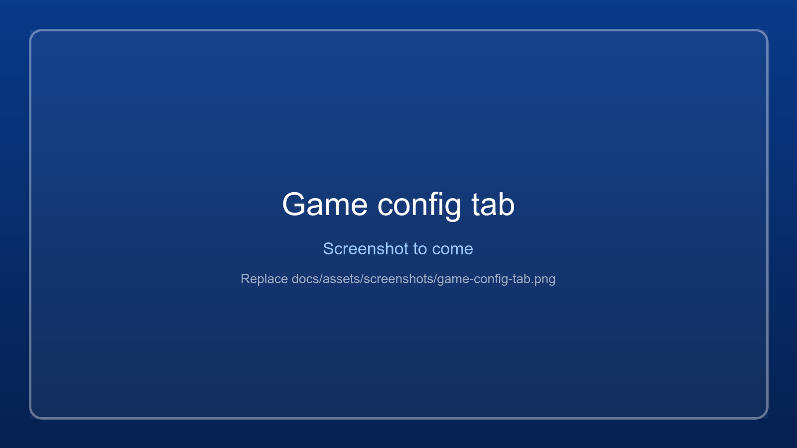

# Game config

The **Game config** tab changes settings in the selected game's **own config files**: the
resolution the game draws at, and its window. The app writes them when you press **Start** /
**Restart**, before the game starts, because the game reads its files only at start-up.

It works for **Unreal Engine 4 games that read loose config files**: the exe is in
`<Project>/Binaries/Win64` and there is a `<Project>/Config/DefaultEngine.ini`. Tekken 7's arcade
builds (Fated Retribution and Round 2) are like that, and so are some other arcade and older PC
releases. Most store games keep their config packed or in your user folder; for them the tab says
it cannot change anything. For a game started through a `.bat` file the app uses the exe the script
started last time.

## The settings

| Setting | What it changes |
|---|---|
| **Write these settings when &lt;game&gt; starts** | On: the settings below are written on every Start / Restart. Off: the files are left as they are. |
| **Render scale** | The resolution the 3D scene is drawn at, in percent (Unreal's `r.ScreenPercentage`). **Above 100 % supersamples**: the game draws larger and the engine scales it down to the window, which gives smoother edges and needs more from the graphics card. **Below 100 %** draws smaller and scales up: faster, but softer. The window and the menus stay at the resolution. *Game's own* leaves it alone. |
| **Resolution** | The game's resolution: in the engine's settings, in the user settings, in `r.setres`, and for Tekken in JConfig's DX resolution. In a window, the game makes its window this size. |
| **JConfig window** | Tekken 7 arcade only (JConfig's *DX Window Mode*): where JConfig puts the game's window. Pick a monitor to make the window fill it. Tekken puts its window back to this rectangle whenever it gets the focus, so this is the setting that stops it from shrinking to 1280 x 720. |

**Write now** writes the settings at once (restart a running game to see them). **Restore
originals** puts the game's own values back. **Open folder** opens the game's `Config` folder.

*Now in the files* shows what the files hold right now, so you can see the effect of each button.

## Render scale explained (with an example)

Think of the render scale as **how many pixels the game draws before it fits the picture into
your window**. The window stays the same size; only the drawing inside it changes.

With a 1920 x 1080 window:

| Render scale | The game draws at | Looks | Graphics card |
|---|---|---|---|
| 50 % | 960 x 540, stretched up | clearly blurry | much less work |
| 75 % | 1440 x 810, stretched up | a little soft | less work |
| 100 % | 1920 x 1080 | normal | normal |
| 150 % | 2880 x 1620, shrunk down | smoother edges, finer detail | about twice the work |
| 200 % | 3840 x 2160, shrunk down | smoothest | about four times the work |

- **Above 100 % = supersampling**: drawing more pixels than the screen has and shrinking them
  makes jagged edges ("jaggies") and shimmering smaller. It costs speed.
- **Below 100 % = upscaling**: drawing fewer pixels and stretching them makes the game faster,
  but softer. Useful on a slow laptop or on battery.

**The setting takes effect when the game starts.** You can change it at any time, but a running game
keeps what it read at start-up: restart it to see the change.

### Example: a sharper Tekken 7, step by step

1. Select Tekken in the game list and open the **Game config** tab.
2. Tick **Write these settings when ... starts**.
3. **Resolution**: *1920 x 1080* (your monitor's size).
4. **Render scale**: *150 % (supersample)*.
5. **JConfig window**: tick it and pick the monitor you play on.
6. Press **Start** (or **Restart** if the game is already running). The app writes the files, then
   starts the game.
7. Look at the stats bar: if the **FPS** drops below 60 (Tekken runs at 60), go back to 125 %.
   If it stays at 60, you can try 200 %.

**Quick test that it works:** set 50 % and start the game once. It should look clearly blurry. If
it looks the same as before, the game does not read these files: tell us (the game log has the
`GameConfig` lines showing what was written).

**To undo everything:** press **Restore originals**, or set the render scale back to *Game's own*.

## Which files and keys

| File | Keys |
|---|---|
| `<Project>/Config/DefaultEngine.ini` | `[SystemSettings]` `r.ScreenPercentage`, `r.Upscale.Quality` (3, the sharpest scaling filter, while the render scale is set), `ResX`, `ResY` |
| `<Project>/Config/DefaultGameUserSettings.ini` | `ResolutionSizeX`, `ResolutionSizeY`, `[ScalabilityGroups]` `sg.ResolutionQuality` (at most 100: the engine caps it, so above 100 % `r.ScreenPercentage` does the work) |
| `Engine/Config/Windows/WindowsEngine.ini` | `[SystemSettings]` `r.setres` (Tekken 7 has `1280x720` here) |
| `<Project>/Binaries/Win64/monitor_misc.bin` | JConfig's window position and size, and its DX resolution |

Before the app first changes a file it keeps a copy next to it, named `<file>.wm-original`. Only
the keys above are changed; everything else in the files stays as it is, also your own edits. A
setting put back to *Game's own* gets its value from that copy, and **Restore originals** does so
for all of them and then removes the copies.

JConfig keeps its settings in `monitor_misc.bin`, the file its dialog reads and writes. After the
app changes it, JConfig's dialog shows the new window and resolution too. Pressing **OK** in JConfig
afterwards writes JConfig's values again; the app writes its own again on the next Start.

## Tips for Tekken 7

- Window on monitor 2 at full size: **Resolution** 1920 x 1080, **JConfig window** *Monitor 2*.
- Sharper picture: also **Render scale** 150 % (or 200 % on a fast card). The window stays
  1920 x 1080, so the downscaled view is not needed.
- A slow laptop: **Render scale** 67 % or 75 %.
- Check the game log (`logs/<game>.log`, lines with `GameConfig`) for what was written, and the
  `Watch` lines for what the game did with its window.

{ .wm-shot loading=lazy }

See also [Display settings](display-settings.md) for the PC's own resolution while a game runs,
[Focus, mouse and hotkeys](focus-and-hotkeys.md) for reaching the app while Tekken holds the keyboard,
and [Downscaled view](downscaled-view.md) for supersampling games that have no render scale.
