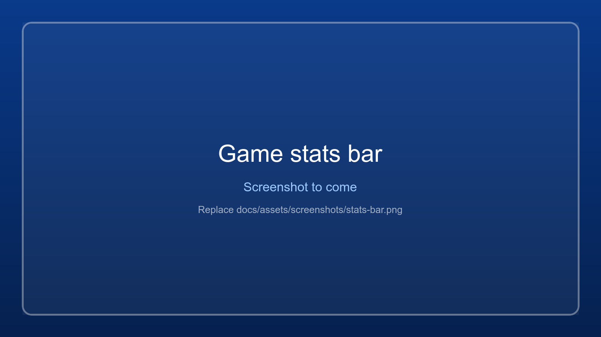

# Game stats and floating bar

{ .wm-shot loading=lazy }

The bar above the status bar shows how the running game uses the PC, once a second:

| Item | What it shows |
|---|---|
| **FPS** | Frames per second over the last second, and the *1 % low*: the frame rate of the slowest 1 % of frames in the last 5 seconds. A 1 % low far below the FPS means stutter. The tooltip has the longest frame. |
| **CPU** | The game's share of the whole CPU (all cores together, as in Task Manager). The tooltip has the whole system's use. |
| **GPU** | The game's busiest GPU engine, as in Task Manager, and the graphics card it renders on. |
| **RAM** | The memory the game has in RAM now (its working set). |
| **VRAM** | The video memory the game has on its graphics card. |
| Power | *Plugged in* or *On battery*, with the battery level. The tooltip has the power plan and the Windows power mode. |

It follows the window selected in the table, or else the selected game's process, also when the
game was started outside the app. Hide it with *View > Game stats bar*; while neither it nor the
floating bar is shown, nothing is read.

## Floating bar

WindowManager stays on top of other windows (*View > Always on top*), which can be in the way. Minimise
it and it turns into a small **floating bar** instead: always on top, but only one line high, with the
game's name, FPS, CPU, GPU and the first warning. It never takes the keyboard from the game.

{ .wm-shot loading=lazy }

- **Drag** it anywhere; the spot is remembered.
- **Double-click** it, or press **Open**, to bring the window back.
- **Right-click** for *Open WindowManager*, *Focus the game* and *Exit*.
- *View > Switch to floating bar* (Ctrl+B) goes there directly. Turn off *View > Minimize to floating bar*
  to minimise to the taskbar as before.

A game in exclusive full screen draws over every window, the floating bar included; in borderless full
screen it stays visible.

Windows only for now: on Linux the bar is not shown (see [Linux](linux.md)).

## Warnings

An orange warning appears on the bar when something is known to slow games down. Hover over it for the
reason; with more than one, the bar shows the first and *(+n)*.

| Warning | Why it slows the game | What to do |
|---|---|---|
| **On battery** | On battery, Windows and the graphics driver lower the CPU and GPU speed, on many laptops to less than half. | Plug in the charger. |
| **Battery saver on** | Battery saver limits the CPU speed and background work. | Switch it off under *Settings > System > Power & battery*. |
| **Power-saving mode** | The Windows power mode is *Best power efficiency*. | Choose *Best performance* under *Settings > System > Power & battery*. |
| **Integrated GPU** | The game renders on the processor's graphics (for example Intel UHD) while the PC has a faster graphics card. | On the **GPU & Power** tab, set the game to *High performance*, then restart the game (see [GPU and power](gpu-and-power.md)). |
| **CPU fully used** | All CPU cores are busy, often because of another program. | Check Task Manager. |

## FPS needs administrator rights

Frames are counted from the DirectX present events that Windows records for every program (the same
source PresentMon and other overlays use). Recording them needs administrator rights, so the bar shows
*needs admin* when the app runs normally. Either start WindowManager with *Run as administrator* each
time, or add your account to the **Performance Log Users** group once. That group may record these
events without administrator rights.

### Adding your account to Performance Log Users

1. Find your account name: open a terminal and run `whoami`. It shows `PC-NAME\name`; you need `name`.
   A Microsoft account shows its local name here too.
2. Open **PowerShell as administrator** (right-click Start > *Terminal (Admin)*).
3. Run, with your name in place of `Admin`:

   ```powershell
   Add-LocalGroupMember -SID S-1-5-32-559 -Member Admin
   ```

   `S-1-5-32-559` is the group's fixed ID, so this works in every Windows language (the group's name is
   translated, for example *Gebruikers van prestatielogboek* in Dutch). The classic command does the same
   on an English Windows: `net localgroup "Performance Log Users" Admin /add`.
4. **Sign out and in again** (or restart). Group membership only counts from the next sign-in.
5. Check it: `whoami /groups | findstr /i "S-1-5-32-559"` prints a line. In the app the bar then shows FPS
   while a DirectX game runs.

Without PowerShell: *Computer Management* (`compmgmt.msc`) > *Local Users and Groups* > *Groups* >
*Performance Log Users* > *Add...* (not on Windows Home, which lacks that page; use the command there).
To undo it: `Remove-LocalGroupMember -SID S-1-5-32-559 -Member Admin`.

DirectX 9 to 12 games are counted. Vulkan and OpenGL games show *-*, and so does a game that is paused
or minimised and draws nothing.

## In the logs

While a game runs, the bar writes to the game's log (see [Logs and troubleshooting](logs-and-troubleshooting.md)):
a summary 10 seconds after the game starts and then every minute, and each warning the first time it
appears. A slow session can then be checked afterwards:

```
[Stats] FPS 24 (1% low 9, worst frame 180.2 ms), CPU 31 % (system 45 %), GPU 99 % on NVIDIA GeForce GTX 1650, RAM 7.2 GB, VRAM 3.6 GB, on battery (battery 72 %), plan High performance
[Stats] On battery: The PC runs on its battery. ...
```
