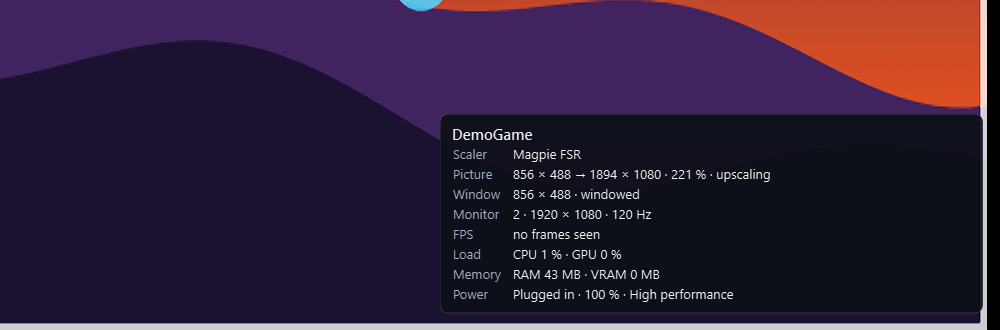
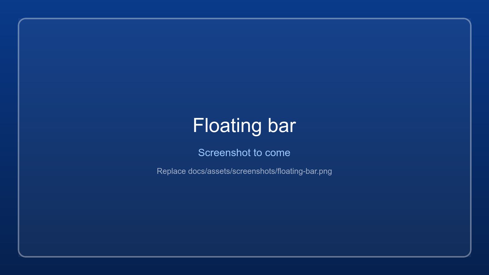

# Game info overlay and floating bar

{ .wm-shot loading=lazy }

While a game runs, a see-through panel in a corner of the game's monitor shows what happens to its
picture and how it uses the PC, once a second. It never takes the keyboard or the mouse (clicks go
through to the game) and stays above Magpie's full-screen picture.

| Row | What it shows |
|---|---|
| **Scaler** | What shows the game's picture: *Magpie FSR* (or another Magpie effect), *Downscaled view*, or *None*. |
| **Picture** | From what size to what size, the scale and the direction: `1280 × 720 → 1920 × 1080 · 150 % · upscaling`. *starting* while Magpie starts, *waiting* / *paused* while another window is in front, naming it (`JConfigTK7R2.exe is in front, click the game`: Magpie only scales while the game is), *not scaling* when something is in the way (see the warnings), or without a scaler the window's size, *not scaled (1:1)*. |
| **Game files** | The resolution and render scale in the game's own config files, when this app has changed them (the [Game config](game-config.md) tab). Shown also when the tab is off: what *Write now* wrote stays in the files. |
| **Render scale** | With a render scale other than 100 %: the size the 3D scene is drawn at, and that it is scaled down (above 100 %) or up (below). |
| **Window** | The game window's drawn area and its mode: windowed, maximized, borderless full screen. |
| **Monitor** | The game's monitor: number, resolution, refresh rate. |
| **FPS** | Frames per second over the last second, and the *1 % low*: the frame rate of the slowest 1 % of frames in the last 5 seconds. A 1 % low far below the FPS means stutter. |
| **Load** | The game's share of the whole CPU (all cores together, as in Task Manager), its busiest GPU engine and the card it renders on, and while Magpie runs **Magpie's own GPU use** (`GPU 29 % on GTX 1650 + Magpie 6 %`): Magpie's upscaling is work in its own process, not in the game's figure. |
| **Memory** | The game's RAM (working set) and the video memory it has on its graphics card. |
| **Power** | *Plugged in* or *On battery*, the battery level and the power plan (orange when it slows the game). |
| ⚠ | Warnings in orange, with what to do: below. |

- **View > Game info overlay > Show over the game**, or **Ctrl+Alt+I** (also while the game has the
  keyboard), shows or hides it. On by default.
- Pick the **corner** in the same menu (top left by default).
- It is **left out of screenshots, snapshots and recordings**, unless you tick *In screenshots and
  recordings* (to record a comparison, for example).
- The **status bar** has the short form at all times: `Magpie FSR: 1280 × 720 → 1920 × 1080 (150 %,
  upscaling)`, orange with the problem in the tooltip when something is in the way. The game log gets a
  `[Picture]` line each time it changes.

It follows the window selected in the table, or else the selected game's process, also when the game was
started outside the app. Windows only for now.

### Why the picture can look wrong with Magpie

| Overlay says | What it means | What to do |
|---|---|---|
| `... → ... · 50 % · downscaling` and *bigger than its monitor* | The game's window is larger than the monitor. Magpie only scales up, so it shrinks the picture, squeezed if the shape differs. With two monitors above each other Windows may give a window nearly twice the monitor's height. | Give the game a resolution below the monitor's: the Game config tab (and with JConfig its DX resolution), or the game's own settings. |
| *Magpie does not scale a maximized or borderless full-screen window* | Magpie needs a window. *Fit to monitor*, *Maximize* or the game's own full screen stop it. | Put the game back in a window (*Windowed*) at the size it should render. |
| *Magpie runs but does not scale the game* | Often a game running as administrator. | Look in `magpie/logs/magpie.log` next to the app. |
| *Magpie is not running* | Magpie starts when the game is started with **Start** in this app. | Start the game from the app. |

Every second of this is also recorded per game for the [Reports](reports.md) tab (sessions, setups compared, picture
comparisons).

## Floating bar

WindowManager stays on top of other windows (*View > Always on top*), which can be in the way. Minimise
it and it turns into a small **floating bar** instead: always on top, but only one line high, with the
game's name and *Open*. The game's stats are on the overlay. It never takes the keyboard from the game.

{ .wm-shot loading=lazy }

- **Drag** it anywhere; the spot is remembered.
- **Double-click** it, or press **Open**, to bring the window back.
- **Right-click** for *Open WindowManager*, *Focus the game* and *Exit*.
- *View > Switch to floating bar* (Ctrl+B) goes there directly. Turn off *View > Minimize to floating bar*
  to minimise to the taskbar as before.

A game in exclusive full screen draws over every window, the floating bar included; in borderless full
screen it stays visible.

## Warnings

An orange warning appears on the overlay when something is known to slow games down, with the reason.

| Warning | Why it slows the game | What to do |
|---|---|---|
| **On battery** | On battery, Windows and the graphics driver lower the CPU and GPU speed, on many laptops to less than half. | Plug in the charger. |
| **Battery saver on** | Battery saver limits the CPU speed and background work. | Switch it off under *Settings > System > Power & battery*. |
| **Power-saving mode** | The Windows power mode is *Best power efficiency*. | Choose *Best performance* under *Settings > System > Power & battery*. |
| **Integrated GPU** | The game renders on the processor's graphics (for example Intel UHD) while the PC has a faster graphics card. | On the **GPU & Power** tab, set the game to *High performance*, then restart the game (see [GPU and power](gpu-and-power.md)). |
| **CPU fully used** | All CPU cores are busy, often because of another program. | Check Task Manager. |

## FPS needs administrator rights

Frames are counted from the DirectX present events that Windows records for every program (the same
source PresentMon and other overlays use). Recording them needs administrator rights, so the overlay shows
*needs administrator rights* when the app runs normally. Either start WindowManager with *Run as administrator* each
time, or add your account to the **Performance Log Users** group once. That group may record these
events without administrator rights.

### Adding your account to Performance Log Users

1. Find your account name: open a terminal and run `whoami`. It shows `PC-NAME\name`; you need `name`.
   A Microsoft account shows its local name here too.
2. Open **PowerShell as administrator** (right-click Start > *Terminal (Admin)*).
3. Run, with your name in place of `Admin`:

   ```powershell
   Add-LocalGroupMember -SID S-1-5-32-559 -Member Admin
   ```

   `S-1-5-32-559` is the group's fixed ID, so this works in every Windows language (the group's name is
   translated, for example *Gebruikers van prestatielogboek* in Dutch). The classic command does the same
   on an English Windows: `net localgroup "Performance Log Users" Admin /add`.
4. **Sign out and in again** (or restart). Group membership only counts from the next sign-in.
5. Check it: `whoami /groups | findstr /i "S-1-5-32-559"` prints a line. In the app the overlay then shows FPS
   while a DirectX game runs.

Without PowerShell: *Computer Management* (`compmgmt.msc`) > *Local Users and Groups* > *Groups* >
*Performance Log Users* > *Add...* (not on Windows Home, which lacks that page; use the command there).
To undo it: `Remove-LocalGroupMember -SID S-1-5-32-559 -Member Admin`.

DirectX 9 to 12 games are counted. Vulkan and OpenGL games show *no frames seen*, and so does a game that
is paused or minimised and draws nothing.

## In the logs

While a game runs, the app writes to the game's log (see [Logs and troubleshooting](logs-and-troubleshooting.md)):
a summary 10 seconds after the game starts and then every minute, and each warning the first time it
appears. A slow session can then be checked afterwards:

```
[Stats] FPS 24 (1% low 9, worst frame 180.2 ms), CPU 31 % (system 45 %), GPU 99 % on NVIDIA GeForce GTX 1650, RAM 7.2 GB, VRAM 3.6 GB, on battery (battery 72 %), plan High performance
[Stats] On battery: The PC runs on its battery. ...
[Picture] Magpie FSR: 1926 × 2160 → 963 × 1080 (50 %, downscaling) | The game's window (1926 × 2160) is bigger than its monitor ...
```
