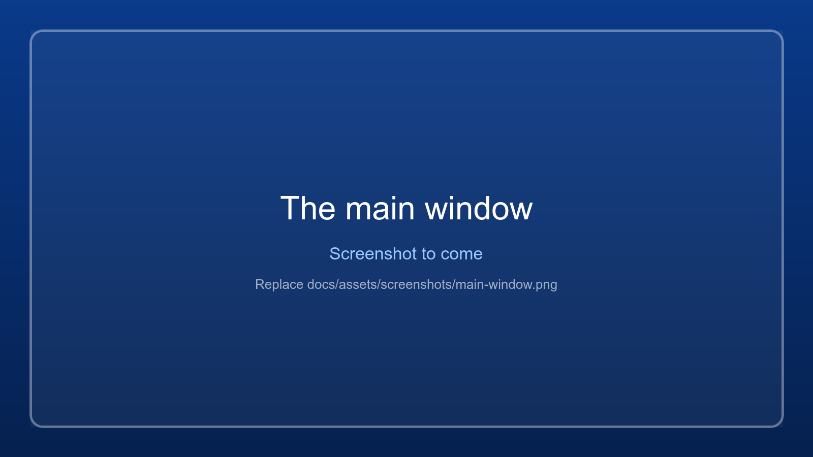

# First steps

WindowManager takes control of the windows of a game or emulator: true borderless full screen, exact sizes,
moving between monitors, keeping a window in place, a sharper downscaled picture and screenshots. It also
changes the PC's display, GPU and power settings, per game if you like.

It runs on Windows, and as a beta on Linux for Steam games under Proton (Bazzite, KDE Plasma). See
[Linux](linux.md) for what works there.

## The first five minutes

1. **Add a game.** Games installed through Steam are already in the dropdown (and come back with
   *File > Find Steam games*). For anything else click **Add game...** (File > Add game..., Ctrl+O) and pick
   an `.exe`, `.bat` or `.cmd`. Give it a short name. It is saved in the dropdown for next time.
2. **Start it.** Click **Start**. For a batch file the app watches for the real game process the batch file
   spawns and switches to it by itself. Already running? Pick the game and press **Scan**.
3. **Let it fit.** Once the game window has settled, the *Fit window to monitor* popup opens.
   **Apply correction** makes the picture fill the monitor exactly. See [Fit to monitor](fit-to-monitor.md).
4. **Select the window.** Every window the game owns is listed in the table. The largest visible one is
   selected for you (the green, bold row). Click another row to act on that one instead.
5. **Adjust.** Use the buttons and tabs. A **green** button means that state is on (for example *Topmost*,
   or *Monitor 2* when the game is on monitor 2).
6. **Save the result.** On *Position & Size*, **Save position** remembers the window for this game and
   **Force saved settings** applies it again later.

{ .wm-shot loading=lazy }

## Where things are

| Area | What it is |
|---|---|
| Game bar | Saved games, Add game, Start, Restart, Kill. See [Games and launching](games-and-launching.md). |
| Action row | Scan, Monitor 1 / 2, Stability, Focus, Destroy, Reset All, Shutdown. See [Window controls](window-controls.md). |
| Window table | The windows of the selected game. |
| Tabs | Window, Position & Size, Presets, Downscale, Display, Game config, GPU & Power, Capture, HelixSR. |
| Game info overlay | Over the game: the scaler (Magpie, downscaled view) and picture sizes, FPS, CPU, GPU, RAM, VRAM, power and warnings. Ctrl+Alt+I. See [Game info overlay](game-stats.md). |
| Status bar | The result of your last action (left) and the target program (right). |

A tour of every control is on [The main window](the-window.md). Every action is also written to the game's
log; see [Logs and troubleshooting](logs-and-troubleshooting.md).

## Good habits

- **Laptops:** play plugged in, and set your games to *High performance* on the **GPU & Power** tab. See
  [GPU and power](gpu-and-power.md).
- **One monitor:** the app stays on top of the game. Minimise it to the [floating bar](game-stats.md#floating-bar),
  or make it see-through with *View > Window opacity* ([Focus, mouse and hotkeys](focus-and-hotkeys.md)).
- **A game that keeps the keyboard:** **F1** switches between the game and the app while a game runs.

## Next

- [Games and launching](games-and-launching.md)
- [Window controls](window-controls.md)
- [Fit to monitor](fit-to-monitor.md)
- [Downscaled view](downscaled-view.md)
- [Shortcuts](shortcuts.md)
