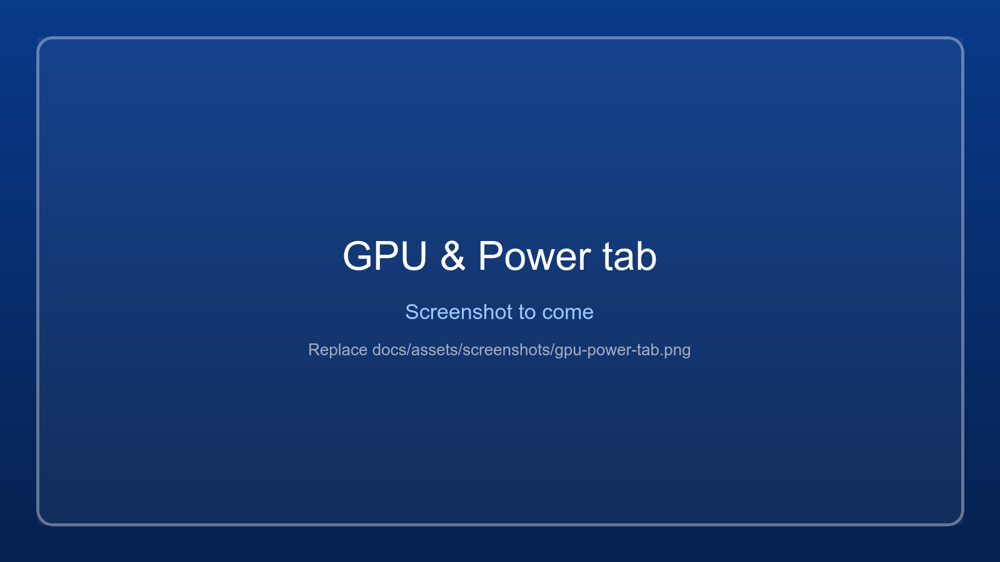

# GPU and power

The **GPU & Power** tab lists the PC's graphics cards with their drivers, sets which card a game renders on,
and switches the power plan and power mode. Windows only for now.

{ .wm-shot loading=lazy }

!!! tip "Tip for laptops"
    Set your games to *High performance*. What *Let Windows decide* picks can change: after an NVIDIA driver
    update it switched from the GeForce to the Intel UHD on a test laptop, so games without their own setting
    rendered on the slow card. And play plugged in: on battery the CPU and GPU run at a fraction of their speed.

## Choosing the graphics card

Laptops often have two graphics cards: one in the processor (Intel UHD, AMD Radeon Graphics), which
saves power, and a faster one (NVIDIA GeForce, AMD Radeon RX). Windows decides per program which one
renders. The **GPU & Power** tab shows:

- **Graphics cards in this PC**: each card, which one is the dedicated (faster) one, and its driver
  version and date (NVIDIA's own number, such as 617.42, for NVIDIA cards).
- **Graphics card for <game>**: Windows' setting for the selected game's exe. Each choice shows the card
  Windows picks for it:
  - *Let Windows decide*: Windows chooses. This is not always the fast card (see below).
  - *Power saving*: the processor's graphics.
  - *High performance*: the dedicated card.
- **Renders on now**: the card the running game actually uses (needs the stats bar shown).

**Set your games to High performance.** What *Let Windows decide* picks can change without warning. On a
laptop with an Intel UHD and a GeForce GTX 1650 it meant the GTX 1650, but after an NVIDIA driver update it
meant the Intel UHD, so every game without its own setting rendered on the slow card. Choosing *High
performance* for a game fixes its card. Check the choice again after a driver update: the tab shows which
card each option means at that moment.

The setting is the same one as in *Settings > System > Display > Graphics* (**Windows graphics
settings...** opens that page), so it also applies when the game is started some other way. It is stored
per exe and takes effect when the game starts, so changing it while the game runs offers **Restart game**.
A game started through a `.bat` file must have been started once from the app, so the app knows its exe.

## Driver updates

The first time the tab opens (and with **Check for driver updates**) the app asks NVIDIA, through the
lookup behind nvidia.com/Download, for the newest Game Ready driver of an NVIDIA card, and shows
*Up to date* or, in orange, *Update available: <version> (<date>)*. **Driver page** then opens that
driver's page. Intel and AMD have no such lookup: **Driver page** opens their download / detection page.
The app never downloads or installs a driver itself.

## Power plan and power mode

The **Power** part of the tab has the same choices as *Control Panel > Power Options*:

- **Power plan**: every plan, also the ones Control Panel hides under *Show additional plans*
  (*Power saver*, and *Ultimate performance* where it exists). Applied at once.
- **Power mode**: Windows' *Best power efficiency* / *Balanced* / *Best performance* (Settings > System >
  Power & battery). Windows only offers it with the *Balanced* plan; with another plan it is greyed out.
- Below: plugged in or on battery, the battery level and battery saver.

**Power options...** opens the Control Panel page, for editing a plan's own settings.

The [game stats bar](game-stats.md) warns when a game runs on the integrated GPU, on battery or in a
power-saving mode.
