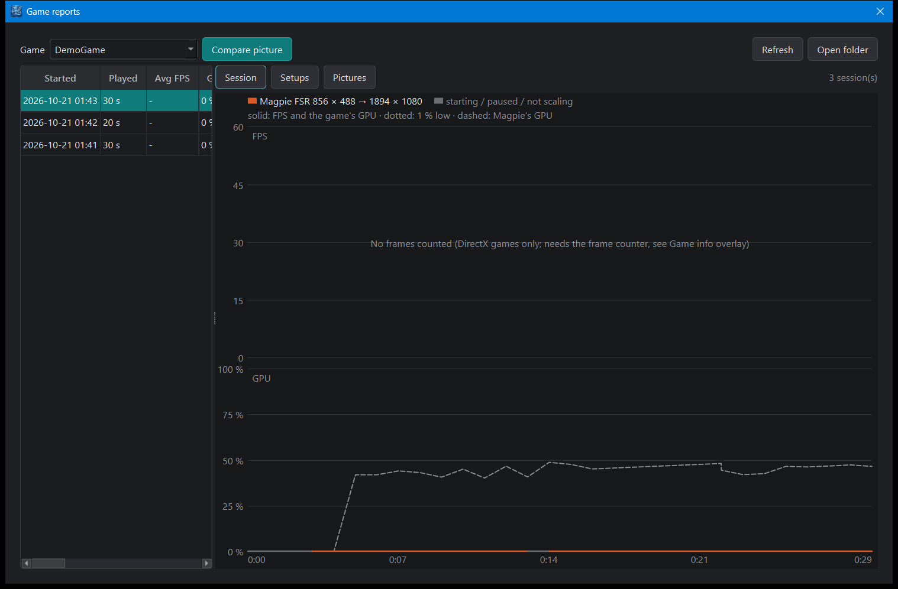
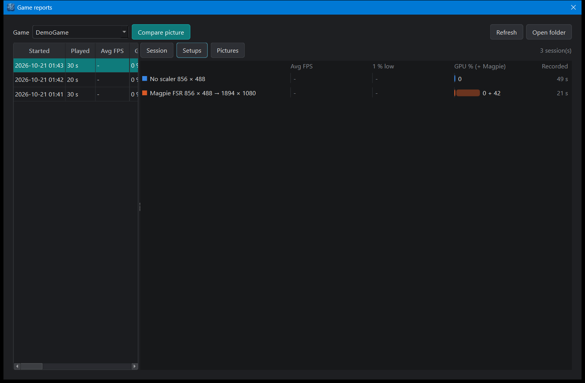
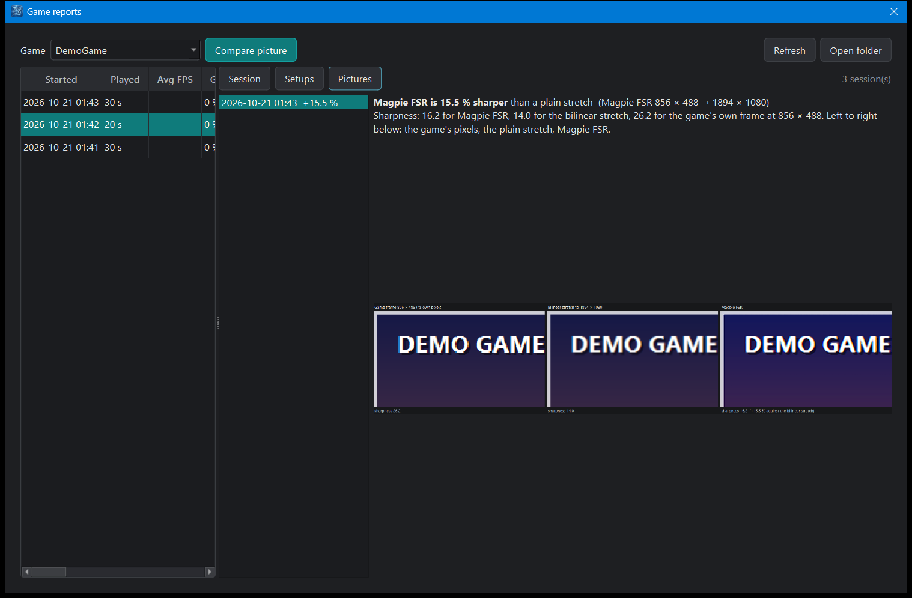

# Reports: sessions, setups and picture comparisons

Does Magpie make a game look better? Does it cost FPS? The **Reports** tab answers that with numbers, per
game. While a game runs, the app records how it ran once a second; afterwards you can look at each session,
compare the *setups* you played with, and compare pictures.

A **setup** is what showed the game's picture and at what sizes, for example
`Magpie FSR 1600 × 900 → 1920 × 1080`, `Downscaled view 3840 × 2160 → 1920 × 1080` or `No scaler 1920 × 1080`.
Moments in between (Magpie *starting*, *paused* because another window was in front, *not scaling*) are
recorded too, in grey, but they are not setups to compare.

## The tab

{ .wm-shot loading=lazy }

- **Game**: the games with recorded sessions.
- **Left**: the sessions, newest first (start, time played, average FPS and GPU, the setups used). Pick one
  to see it over time.
- **Session**: the picked session over time. Above, the **FPS** (solid) and the 1 % low (dotted); below,
  the game's **GPU %** (solid) and **Magpie's own GPU %** (dashed). The line takes the colour of the setup
  at that moment. Hover for the values at that second.
- **Setups**: the game's setups over all its sessions, one row each: average FPS, 1 % low, GPU (the game's
  plus Magpie's, written as `29 + 6`) and how long it was recorded. A setup keeps its colour in every view.
- **Pictures**: the picture comparisons (below).
- **Larger view** opens the same in a window of its own; **Open folder** shows the files.

{ .wm-shot loading=lazy }

Sessions shorter than 10 seconds are not kept. Seconds without a game window (loading, closing) are left out.

## Picture comparison

Is Magpie's upscaling sharper than a plain stretch? To measure it:

1. Start the game with Magpie (Magpie tab) and let it scale. The overlay shows `Magpie FSR: ... upscaling`.
2. Put the game on a **still screen**: pause, a menu, character select.
3. Reports tab > **Compare picture**. The game gets the focus (Magpie only draws live frames while it is in
   front), and 2 seconds later the app captures, at the same moment:
    - the game's **own frame** at its own size (for example 1600 × 900);
    - what **Magpie** shows on the monitor (1920 × 1080).
4. The game's frame is also stretched to the monitor size with a plain **bilinear** filter: what you would
   get without Magpie (Windows or the monitor stretching the picture).

All three get a **sharpness** score: the strength of the edges in the picture (the RMS of the brightness
gradient, "Tenengrad"). A blurred edge scores lower than a crisp one. The verdict compares Magpie with the
bilinear stretch: *Magpie FSR is 15.5 % sharper than a plain stretch*. The game's own frame scores highest,
because it has the fewest pixels per edge; it is there for reference.

{ .wm-shot loading=lazy }

The side-by-side zoom shows the same part of the picture (where it has the most detail) three times, enlarged
2x with no smoothing: the game's pixels, the bilinear stretch, Magpie. Double-click the entry in the list to
open the full image. The full-size shots are in the folder too.

Sharper is not always better: very strong sharpening can add halos. Look at the zoom as well as the number.
The two shots are a frame or two apart, so a moving picture gives a less fair score.

## Is upscaling worth it?

Compare a session without Magpie (native resolution) with one with Magpie on the **Setups** view:

- **The same FPS with a lower GPU %** for the game: rendering smaller saves work. Add Magpie's share
  (`29 + 6`) to see the total.
- **The same FPS and the same GPU %**: the game was not limited by the GPU (for example a game capped at
  60 FPS with the GPU at 30 %). Upscaling then gains nothing; a higher render scale (Game config tab) uses the
  spare GPU power for a sharper picture instead.
- **Higher FPS with Magpie**: the game was GPU-bound and upscaling helps.

## Files

Everything is in `reports/` next to the program, one folder per game:

| File | What it holds |
|---|---|
| `<start>-samples.csv` | One row a second: time, FPS, 1 % low, CPU, GPU, Magpie's GPU, RAM, VRAM (MB), setup, scale %, on battery. Written while the game runs, so a crash keeps it. |
| `<start>.json` | The session's summary (`schemaVersion` 1): game, exe name, Steam AppID, start / end, app version, GPU, monitor, warnings, and per setup the averages and peaks. |
| `compare-<time>.json`, `.png` | A picture comparison: sizes, the three sharpness scores, the gain, and the side-by-side image; `-game.png`, `-bilinear.png`, `-scaled.png` are the full shots. |
| `reports/sessions.csv` | One row per session of every game: for a spreadsheet. |

No private data is stored: the game's name and exe file name only, no user names, folders, PC name or
serial numbers.
